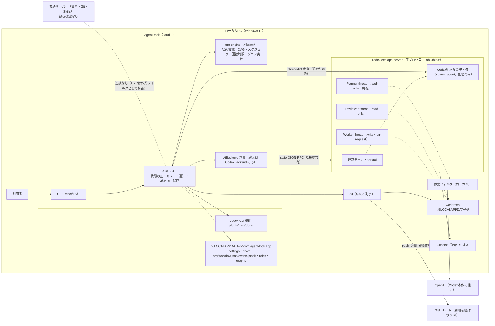
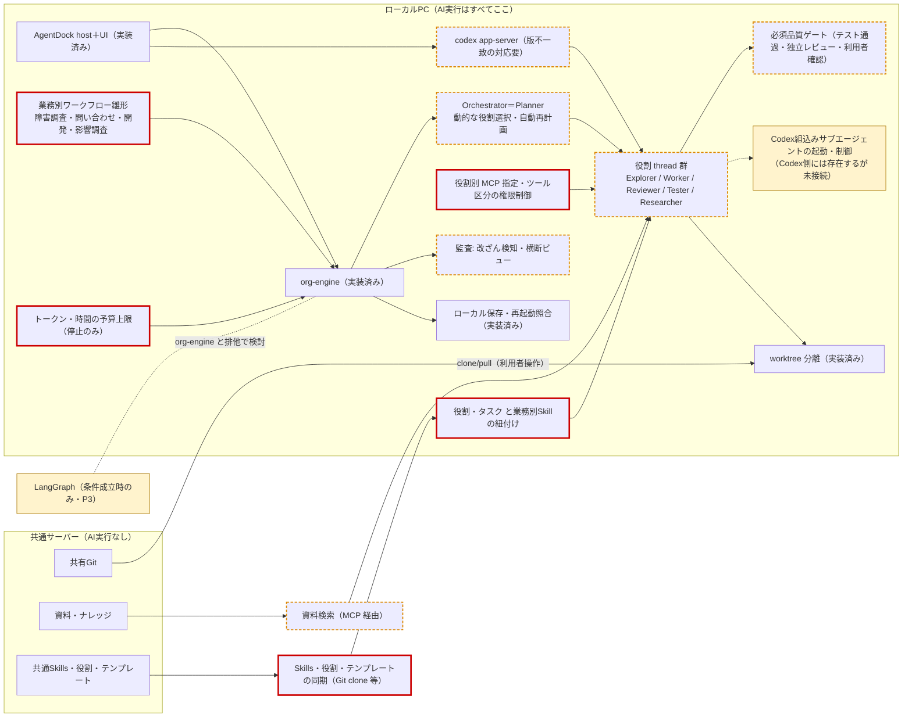

# AgentDock AIエージェント構成・現状実装調査 統合報告（2026-10-23）

対象: feature/org-engine（HEAD 0e1b11e）。入力は `BRIEF.md` と part-1〜4。統合時にコードで確かめた点は「統合時確認」と書く。ソース・設定は変更していない。
表記: 「推測」はコードで直接確かめていない見立て、「未確認」は読んでいない・実機で見ていないもの。種別は「実装済み／UIだけ／バックエンドだけ／設計のみ／Codex側には存在するが未接続」で区別する。パスは `app/` 起点（`S`=`src-tauri/src`、`E`=`org-engine/src`）。
（注: 本文は統合担当の返答をそのまま保存したもの。構成図は Mermaid。班ごとの詳細は part-1〜4 を参照。）

## (a) 結論の要約
1. AI実行はPC内で完結している。AgentDock自身にHTTP通信コードはなく、`codex.exe app-server` を子プロセスで起動して stdio JSON-RPC でつなぐ（A01・A02 実装済み）。共通サーバー連携は無い（A18 未実装）。
2. マルチエージェントは独自の組織実行（org-engine）で実装済み。Planner が計画し、依存つきで並列実行（Worker同時2・全体3）、Reviewer が差し戻す。グラフ定義、イベント記録、再起動後の照合まで動く（単体テスト198件合格。実Codexでの並列は未確認）。
3. Codex組込みのサブエージェント（spawn_agent）は監視だけで、AgentDockからの起動・制御は「Codex側には存在するが未接続」。方針9と独自エンジンの関係は要判断（f-6）。
4. 主な不足: 業務別ワークフロー雛形、Planner の役割選択、Tester役と合否ゲート、トークン・時間の上限、役割への Skill/MCP 指定、共通Skillの同期、監査の改ざん検知。
5. 「自動再計画1回」は上限値があるだけで、発火経路が無い（統合時確認）。自動の再計画は quality-loop の replan 辺（周回上限1）だけ。
6. 安定性の要対応: Codex 0.163.0 と対象版 0.162.1 の不一致、組織経路の UNC 検査漏れ、承認応答の同時実行の排他。
7. LangGraph は現時点で導入不要と判断できる。org-engine の拡張で不足を埋められる。導入するのは §e-4 の条件が成立したとき。

## 食い違いの確定（統合時確認）
| # | 食い違い | 確定 |
|---|---|---|
| a | A03（班2）「`AutoReplanSpent` の発行元が無く未配線」と、A12（班3）「自動再計画1回は実装済み」 | 班2が正しい。`try_auto_replan` を呼ぶのは `E/persist.rs:412-414`（事象の再生）とテスト `E/limits.rs:127-131` だけ。`AutoReplanSpent` が出てくるのは `persist.rs:283,412` と `S/rules/org_timeline.rs:274` だけ。再計画は利用者操作で（`E/planned.rs:72`）、Planner 2回目以降は `Replan{scope_changed:true}`＝利用者承認（`planned.rs:130-135`）。quality-loop の verify→plan（`E/graph/templates.rs:55-56`、maxRounds 1）はグラフ辺の周回上限（`E/graphrun.rs:470-504`）で、`max_auto_replans` とは別。`DEFERRED.md:48` とも一致する。 |
| b | `org_start` の UNC 検査漏れと、既知の無反応不具合の関係 | 検査漏れは事実で、因果は確認不能。`S/host/org/mod.rs:268` は `is_dir` だけ。`precheck_repo_ready`（`S/host/gitprep.rs:107`）は `git_prep_folder_refusal`（`:74-76`）を通らない。`org_create_role_chat`（`S/host/org/ports.rs:303-314`）は `backend.start_chat` を直接呼び、`verify_folder_set`（`S/host/mod.rs:671-688`）を経ない。依頼整理（`S/host/org/intake.rs:123`）は `start_chat` 経由なので拒否される。推測: async 内の同期 `is_dir`（`org/mod.rs:268`、`host/mod.rs:648` も）は、到達できない UNC で長く止まり得る。実機未確認。（補足: 司令塔の調査では、UNC で無反応になるという報告は2026-10-22 のユーザー報告として別途ある。DEFERRED への記載は、統合時点では無い。） |
| c-1 | 標準役割は「5役」（班2）か「3役」（班3・4）か | 5役（`E/roledef.rs:282-288`、テスト `:370`）。standard の plannedTasks で使えるのは worker と reviewer（`templates.rs:22`）、verifier と writer はグラフの agent ノード経由。 |
| c-2 | `max_tasks` の既定値 | 20（`E/types.rs:429`）。 |
| c-3 | 利用上限停止の扱い（班3と `DEFERRED.md:65` の食い違い） | 現行は班3の記述どおり（`E/core.rs:1112-1114,323,332,356`）。DEFERRED は古いと見られる。実機での再開は未確認。 |
| c-4 | 役割に Skill を結び付ける欄 | 無い。`E/` で `skill`・`mcp` は0件。 |
| c-5 | 走行中の追加指示 | 確認不能。コミット b8a3022 に「user interjection via steer/next-turn note」と `ports.rs:178 steer` がある。UIからの到達性は未確認。 |

## (b) 実装対応表
| ID | 判定 | 実装の概要 | 根拠 | 動作確認 | 不足・制約 |
|---|---|---|---|---|---|
| A01 | 実装済み | 独自: Tauri ホストが app-server を子プロセスとして起動し stdio で通信。AgentDock自身の HTTP 通信は無い。外部通信は Codex本体→OpenAI、利用者操作の git push と codex cloud だけ。 | `Cargo.toml:19-30`、`S/codex/process.rs:116-173`、`S/gitops/push.rs:1-6`、`S/codex/cli.rs:20-31` | grep で HTTP 系依存0件（part-1）。通信の観測は未実施。 | Codex・MCP の通信先は未確認。`csp: null`（推奨/小）。 |
| A02 | 実装済み（App Server）／CLI補助は一部 | 独自: initialize（experimentalApi）、Job Object、状態変換、照合、承認UI。Codex: thread/turn/承認/モデル/サブエージェント/履歴。CLI は plugin・mcp・cloud の許可列挙のみ。trait `AiBackend`＋`ParityOps`、実装は1つ。 | `process.rs:22,50-80`、`adapter.rs:700,735-762`、`events.rs:39-73,123-308,485-651`、`backend.rs:525-582` | 4件合格。実機は 0.163.0 で、版不一致の警告つき接続（未確認）。 | 0.163.0 の照合（必須/小）。`Arc<CodexBackend>` 具象型（将来/中）。 |
| A03 | 一部実装 | Planner が outputSchema で計画を返し、検証・ポリシー判定で自動承認か利用者承認。利用者の差し戻し再計画あり。自動再計画は未配線（a）。quality-loop の replan は動く。Codex の plan モードはモード指定のみ接続。 | `E/prompt.rs:27,42`、`E/planned.rs:72,121-153`、`E/dag.rs:18`、`E/policy.rs:50`、`E/limits.rs:47` | 198件合格。Planner の実出力は未確認。 | 結果を見ての自動再分解なし（必須/中、方針は要判断）。 |
| A04 | 一部実装 | 独自: タスクごとに役割 thread を作成・送信し、最終メッセージを read で回収（resume しない）。Codex の子・孫は走査して表示するだけで、Codex側には存在するが未接続。未終了の子孫があればタスクを完了扱いにしない。 | `S/host/org/ports.rs:68,170-206,298`、`adapter.rs:36,947`、`tree.rs:68`、`convert.rs:442-491` | tree・convert のテスト合格。実機は未確認。 | Codex サブエージェントとの分担（要判断 f-6）。 |
| A05 | 一部実装 | 役割定義ファイル（標準5役）で拡張でき、権限を広げる定義は確認まで無効。standard で Planner が選べるのは worker・reviewer だけで、プロンプトにも固定で書かれている。 | `E/roledef.rs:61-288`、`S/host/org/roles.rs:51,77`、`templates.rs:22`、`E/prompt.rs:31` | roledef のテスト合格。 | Explorer/Researcher/Tester を動的に選べない（推奨/中）。 |
| A06 | 実装済み | 純粋関数のスケジューラ（依存・全体・書込み・役割別・残りturn）。未確認タスクはスロットを保持。worktree で分離。マージ・push はしない。 | `E/scheduler.rs:36-71`、`types.rs:418-425`、`S/host/worktree/org.rs:22` | scheduler のテスト合格。実機の並列は未確認。 | グラフ内の扇状並列は不可（V6、`validate.rs:301-306`）。トークン上限なし。 |
| A07 | 一部実装 | JSONグラフ（agent/gate/router/plannedTasks、V1〜V12）。同梱は standard と quality-loop だけ。 | `E/graph/*`、`E/graphrun.rs`、`S/host/org/graphs.rs` | graphrun・graphs のテスト合格。 | 業務別雛形なし（必須/中）。並列調査→統合を書けない（推奨/大）。 |
| A08 | 一部実装 | Codex の `skills/list` 読取りと、独自の選択UI・`skill` 入力での明示指定。共有・同期は無い。組織実行は Skill 指定なし。 | `parity.rs:184,189,510`、`compose.rs:69,86`、`adapter.rs:132-136` | 43件合格。 | 役割への Skill 指定（推奨/中）。共通Skill同期（推奨/中、`~/.codex` の合意との整合が要る）。 |
| A09 | 一部実装 | Codex の状態読取り・OAuth・再読込み。独自の CLI 補助（stdio の add/remove、前後照合、自動rollbackなし）。ツール呼出しは Codex 任せ。 | `parity.rs:198-238,801,864-866,920`、`cli.rs:20-30` | 43件合格。実接続は未実施。 | 役割別 MCP（推奨/中）。HTTP/SSE 型（推奨/小〜中）。ツール一覧（将来/小）。 |
| A10 | 一部実装 | 権限プリセット6種を approvalPolicy＋sandbox に変換。承認5種をカードにし、代行しない。計画の Effect 宣言（自己申告）があれば承認必須。権限を広げる役割定義は確認まで無効、never は拒否。 | `backend.rs:180-188`、`convert.rs:707-726`、`events.rs:505-673`、`E/policy.rs:50`、`E/roledef.rs:128-238` | 21件・198件合格。 | 実際の操作で区分する層なし（推奨/大）。Windows sandbox の実挙動は未確認。 |
| A11 | 一部実装 | Reviewer は別 thread・detached・read-only で pass/rework。差し戻し上限2で ReworkLimit になり利用者が選ぶ。graph は verdict3。組織外は `review/start`。 | `E/schemas.rs:74-183`、`E/planned.rs:199-256`、`E/limits.rs:62-75`、`parity.rs:149,477-489` | 198件合格。実 Reviewer は未実行。 | Tester 役とテスト通過ゲートなし（必須〔f-3次第〕/中）。 |
| A12 | 実装済み（組織内）。自動再計画の上限だけ未配線 | turn30（送信前に数える）、差し戻し2、再送3（利用者操作のみ、受理不明は拒否）、利用上限で全体停止（failed にしない）、停滞は通知のみ、辺の周回上限。 | `E/limits.rs:6-75`、`types.rs:397-450`、`core.rs:261,313,1112-1114`、`S/host/org/stall.rs:65` | 198件合格。 | トークン・時間の上限なし（推奨/中）。組織外にループ防止なし。 |
| A13 | 実装済み | AgentState と Freshness を別軸に持つ。通信断は unknown。推定で親を付けない。Dock で不明を別表示。 | `model.rs:198,261,289`、`tree.rs:68`、`host/mod.rs:428-515`、`Dock.tsx:50-106` | tree のテスト合格。描画は未確認。 | 大規模時は未確認。ちらつき（DEFERRED）。 |
| A14 | 実装済み | Codex の resume（利用者操作時）・archive と、独自の chat.json、作業中アーカイブ、確認付き削除、継続チャット。 | `manage.rs:201-357`、`continuity*.rs`、`purpose_draft.rs:285` | lifecycle 1件のみ合格。 | 横断検索は未確認。組織ワークフローの作業中アーカイブなし（DEFERRED）。 |
| A15 | 一部実装 | 受理不明は再送しない。queue.json を永続化。wake 時に照合。Job Object（KILL_ON_JOB_CLOSE なし）。組織は再起動時に照合が必要な状態にして停止する。Dispatched を先に永続化。epoch 失効。単一起動。 | `E/persist.rs:824,871`、`core.rs:1489-1520`、`grant.rs:50`、`lifecycle.rs:488-591`、`queue_driver.rs:894-989` | 10件・25件合格。Job Object と wake は実機未確認。 | 通常チャットは自動継続しない（方針どおり）。presend のテストは未実行。 |
| A16 | 一部実装 | activity・decisions・events・workflow を記録。原子書込み、追記＋sync、自動削除なし。 | `store/atomic.rs:22,60`、`store/mod.rs:381-436`、`store/org.rs:104` | 6件・10件合格。 | 改ざん検知なし（推奨、監査用途なら必須/中）。横断ビューなし。 |
| A17 | 実装済み | 通常チャットは turn ごとの Git 控え・差分・戻す。組織は成果物パネル・確認付き取込み・取消し。 | `changes.rs:1046,1112`、`org/artifacts.rs:182-747`、`gitops/import.rs:96-343` | 未実行。並行時の不安定なテストあり（DEFERRED）。 | 成果物と根拠の紐付けは未確認（推奨/中）。 |
| A18 | 未実装（UNC拒否は非対称） | 専用の連携機能なし。通常の作業フォルダでは UNC を拒否するが、`org_start` と役割チャット作成は `is_dir` だけ（b）。 | `rules/work_folders.rs:96-221`、`host/mod.rs:665-689`、`org/mod.rs:268`、`ports.rs:303` | 30件合格。 | 組織経路の検査（推奨/小）。共通資産の配布（推奨/中）。 |
| A19 | 一部実装 | model/list から選択、effort・serviceTier を送り、受理値と照合。組織上限は開始時に入力。サブエージェントのモデルは記録値を表示するだけ。 | `adapter.rs:159-176,1096`、`local.rs:697-767`、`E/types.rs:397-451`、`org/mod.rs:174,274-297` | 12件合格。 | 予算上限なし（推奨/中）。既定値を設定に保存できない（推奨/小）。通常チャットの同時数（将来/中）。 |
| A20 | 一部実装 | 役割定義・グラフの追加、開始時の写し、目的メモ。Skill はチャット単位で、役割との紐付け欄は無い。 | `org/roles.rs`、`org/graphs.rs:59-284`、`E/roledef.rs` | 未実行。 | 業務別雛形・共有配布（推奨/中）。 |
| A21 | 現時点で導入不要（評価） | 状態機械・周回つきグラフ・永続化・再起動照合・人の判断ゲートは org-engine に実装済み。 | `E/core.rs`、`E/graphrun.rs`、`E/persist.rs:824-871`、`E/graph/validate.rs` | — | 不足は org-engine の拡張で対応できる（§e-4）。 |
| A22 | 一部実装 | 状態の正はホスト。組織チャットは UI とホストの両方で送信を拒否。手動切替は片方向。OrgGrant＋epoch。応答結果を4種に区別。エンジンは承認に応答しない。 | `host/mod.rs:920,1211-1240`、`org/grant.rs`、`rpc.rs:183`、`OrgPane.tsx:101` | grant 5件合格。 | `respond_request` の排他なし（推奨/小）。承認待ちが進めない件（原因未確認）。 |

## (c) 構成図
### 現行実装

### 目標構成との差分（赤太枠=未実装、橙点線=一部、黄=要判断）

## (d) ギャップと優先順位
**P0（安定性・権限・安全性）**
- P0-1 Codex 0.163.0 の schema 差分照合、TARGET_VERSION 更新、`thread/readState/` の扱い — 必須/小（注: 照合は2026-10-18 に実施済み。差分は新通知のみ。TARGET_VERSION の更新は未実施）
- P0-2 組織経路（`org_start`・役割チャット作成）の UNC/ネットワークドライブ検査と、`is_dir` の spawn_blocking 化 — 推奨/小
- P0-3 組織の承認待ちが進められない件の原因確定（要確認） — 必須/中
- P0-4 `respond_request` の排他 — 推奨/小
- P0-5 「空き0」誤検知の原因確定（要確認） — 推奨/中
- P0-6 `csp: null` を絞る — 推奨/小
- P0-7 実Codexでの並列・役割チャット・Reviewer の実機確認 — 必須/小（手順のみ）

**P1（基本のマルチエージェント運用）**
- P1-1 業務別ワークフロー雛形（現行グラフ形式で書ける範囲） — 必須/中
- P1-2 Tester 役とテスト通過ゲート — 必須（f-3次第）/中
- P1-3 Planner に有効な役割表を渡し、動的に選べるようにする — 推奨/中
- P1-4 自動再計画を配線するか、上限値と表示を外すか — 推奨/中（撤去なら小）。要判断
- P1-5 Codex サブエージェントとの分担を決める（f-6） — 必須（方針9）/判断のみ
- P1-6 トークン・時間の予算上限（停止で、failed にはしない） — 推奨/中
- P1-7 組織上限の既定値を設定に保存 — 推奨/小
- P1-8 走行中の追加指示がUIから届くかの確認 — 推奨/小
- P1-9 組織ワークフローの作業中アーカイブ・古い記録の削除 — 推奨/小〜中

**P2（Skill・MCP・監視・運用）**
- P2-1 役割・ノードへの Skill 指定 — 推奨/中
- P2-2 共通資産の配布（共有Git、利用者操作、`~/.codex` に書くなら明示操作と前後照合） — 推奨/中
- P2-3 役割別 MCP（Codex 側で絞れるかの実測が先） — 推奨/中
- P2-4 MCP の HTTP/SSE 型・ツール一覧 — 推奨/小〜中、将来/小
- P2-5 扇状並列（V6 の制約を外す） — 推奨/大
- P2-6 監査の改ざん検知・横断ビュー — 推奨/中
- P2-7 成果物と根拠の紐付け — 推奨/中
- P2-8 実際の操作に基づく権限区分 — 推奨/大
- P2-9 バックエンドの trait 化の整理 — 将来/中

**P3（LangGraph 等）**
- P3-1 §e-4 の条件を見張る — 将来/小
- P3-2 導入するなら置換か範囲分割の境界設計（Python/Node の同梱を伴う） — 将来/大

## (e) 結論
1. **現在のAgentDockで実現できる範囲**: PC内完結の Codex 接続と通常チャット一式。組織実行（計画→ポリシー判定→依存つき並列→Worker と Reviewer→確認付き取込み）、グラフ（周回・人の判断ゲート・分岐）、事象記録と再起動後の照合、二重送信の防止、利用上限での停止。状態と鮮度の別軸表示、子孫の監視。並列・Reviewer・Job Object・wake は「実装済み・実機未確認」。
2. **Codex標準機能の活用で実現できる範囲**: モデル・推論強度・権限・承認、Skill の明示指定、MCP のツール呼出しと elicitation、review、compact、goal、plan モード、cloud（いずれも接続済み）。spawn_agent は Codex側には存在するが未接続で、AgentDockからは利用可能と判定しない。役割別 MCP が Codex で絞れるかは未確認。
3. **AgentDock独自開発が必要な範囲**: 業務雛形、Tester とゲート、役割選択、自動再計画（採る場合）、予算上限、役割への Skill/MCP 指定、共通資産の配布、改ざん検知、扇状並列。
4. **LangGraph（A21）**: 現時点で導入不要。
   - 理由1: LangGraph の中核（循環グラフ、永続化、中断・再開、人の判断、回数制限）は org-engine に既にある（`E/core.rs`、`graphrun.rs:470-517`、gate、`persist.rs:824-871`、`core.rs:1489-1520`、198件合格）。
   - 理由2: 「Codex単体では満たせない要件」（厳密な状態遷移、thread 間の依存、再起動耐性、受理不明の照合）は存在するが、既に独自実装で満たしている。LangGraph を足すとオーケストレーターが二つになり、方針9に反する。
   - 理由3: 現行の不足は org-engine の拡張で埋まる。
   - 理由4: ホストが Rust なので、別ランタイムの同梱が要る（コスト大は推測）。
   - **導入条件**（どれか1つ）: ①Codex 以外の実行主体を同じワークフローに混ぜる必要があり、境界の拡張では賄えない。②数十以上の動的な扇状並列や入れ子のサブグラフが常用になり、拡張コストが導入コストを上回る。③任意時点からの分岐再実行（time-travel）が要件になる。④組織として LangGraph/LangSmith を共通で使う決定がある（実行はPC内のまま）。
   - **不要条件**（すべて成立している間）: 実行主体が Codex だけ、ワークフローが現行のグラフ形式で表せる、並列は少数で上限を足せば足りる、監査・復旧がローカルの記録で足りる。
5. **推奨順序**:
   1. P0-1・P0-2・P0-4
   2. P0-7 実機確認と P0-3 原因確定
   3. f-6 と f-1 を利用者が決める
   4. P1-1・P1-3・P1-2
   5. P1-6・P1-7・P1-4
   6. P2-1 → P2-2 → P2-3 → P2-5
   7. P3 は条件が成立するまで着手しない

## (f) 未決定事項（選択肢の整理。決めていない）

**f-1 サブエージェント起動の承認方式**
現状は、Effect 宣言・無効役割・並列超過・turn 不足のどれも無ければ自動承認（`E/policy.rs:50`）で、実態は条件付き自動。「常に承認」の設定は無い。Codex組込みのサブエージェントには関与していない。
- 完全自動: 速い。ただし Effect は自己申告なので安全側の後退。現状から近い（小）。
- 条件付き自動: 現状そのもの。条件の追加は小〜中。
- 計画承認型: 必ず人が見るが、毎回待ちが発生する。設定を足すだけ（小）。
- 業務・グラフごとに選ぶ: リスクに合わせられるが、設定が増える（中）。
- Codex サブエージェントにも承認をかけたい場合は、f-6 の決定が先。

**f-2 並列数・トークン等の上限**
現状は Worker2・全体3（1〜4）、turn30（1〜200）、差し戻し2、再送3、タスク20、停滞通知30分。トークン・時間の上限は無く、既定値は設定に保存できない。
- 現行のまま: 変更なし（0）。
- 既定値を設定化: 利用者ごとに調整できる（小）。
- トークン予算で停止: コスト管理ができる。未取得を0扱いしない設計が要る（中）。
- 時間上限で停止: 停滞は「通知のみ」という合意 Q10 と衝突するので、合意の見直しが先（中）。
- 上限4の引上げ: 並列調査が速くなるが、先に実測が要る（小）。

**f-3 業務ごとの必須品質ゲートと承認条件**
現状は、Reviewer の pass／verifier の verdict3／任意の gate ノードで、エンジンが強制するゲートは無い。
- グラフ作者に任せる: 柔軟だが最低品質の保証が無い（0）。
- 業務雛形にゲートを組み込む（開発＝テスト通過＋独立レビュー、障害調査＝根拠の引用確認＋利用者確認）: 中。
- エンジンで必須にする（グラフ検証で強制）: 抜け道は無くなるが、方針4との兼ね合いがある（中）。
- 完了前に常に利用者確認: 最も安全で、手間がかかる（小）。

**f-4 共有サーバーに保存する情報の範囲**
現状は連携なし。UNC は拒否（組織経路は漏れ）。`~/.codex` は明示操作のときだけ変更する合意。
- Git のみ（Skills・役割・グラフ・資料を clone）: 版管理ができる。`~/.codex/skills` に置くなら確認が要る（小〜中）。
- ＋資料検索（MCP）: 中。
- ＋成果物の保存: 機密の扱いと送信経路の追加が伴う（中）。
- ＋実行ログ・監査の保存: プロンプトやコード断片を含み、権限設計が要る（中〜大）。

**f-5 LangGraph の判断基準と評価時期**
判断基準は §e-4。評価時期の選択肢:
- 条件が成立したときだけ評価する: 工数は最小だが、条件を誰が見張るか決める必要がある。
- P1 の完了後に一度評価する: 実運用の不足が見えてから判断できる。
- P2-5（扇状並列）に着手する前に評価する: 最も実装コストが大きい項目の前で比較できるが、判断が P2 まで延びる。

**f-6（追加の要判断）Codex サブエージェントと組織実行の分担**
現行は独自オーケストレーター（AgentDock が役割 thread を制御）なので、方針9と緊張関係にある。役割 thread の中で Codex がさらに子を作ると二層の制御になる（現行は、子が終わるまで完了扱いにしないだけ）。
- 現行維持: 再起動耐性・上限・監査は既にある。方針9とは緊張したまま（0）。
- 主従分担（エンジンは工程・ゲート・上限、工程内の分岐は Codex に任せる）: P2-5 が不要になり得る。ただし Codex の子を AgentDock から制御できない（中、実測が要る）。
- Codex 中心へ移行: 方針9には最も忠実。依存・上限・照合・ゲートの強制を失い、Codex に起動制御APIがあって AgentDock から使えるかも未確認（大）。
